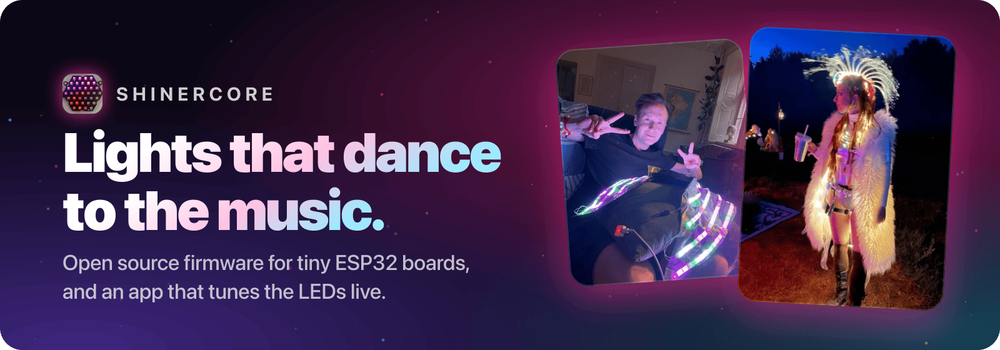
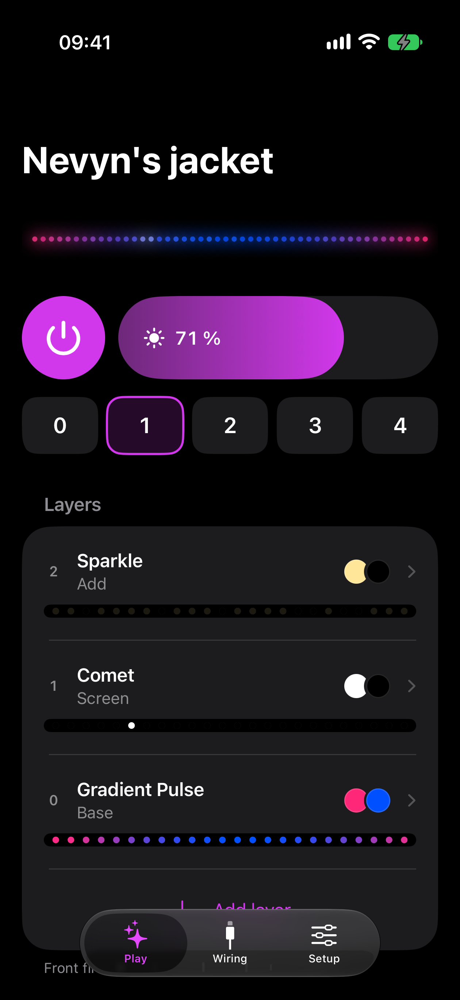
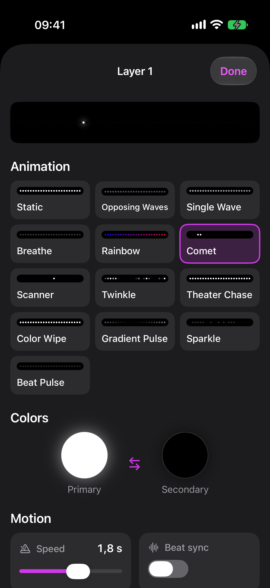
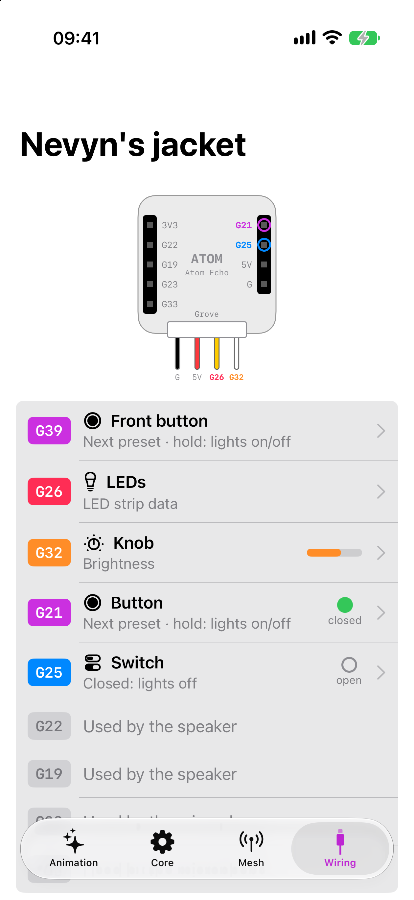
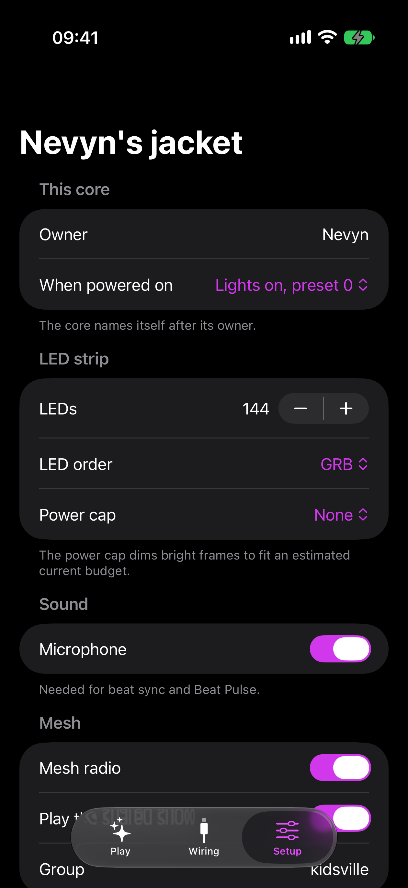

   
  In the photos: <a href="https://www.instagram.com/nilssonsgustav/">Gustav Nilsson</a>, who runs the Shiny Workshops with me, and <a href="https://www.instagram.com/valentinafellina/">Valentina Fellina</a>.

<table align="center">
  <tr>
    <td align="center">
      <b>1. Flash a board on your Mac</b>  
       
      macOS 14 or later, board over USB · <a href="https://github.com/nevyn/shinercore/tree/main/flasher">how it works</a>
    </td>
    <td align="center">
      <b>2. Tune it from your phone</b>  
       
      iPhone, iPad and Apple silicon Macs
    </td>
  </tr>
</table>

  <b><a href="https://nevyn.dev/shinercore/">nevyn.dev/shinercore</a></b> has what you need and how to start.
  Photos of what people build: <a href="https://www.instagram.com/shiner.core/">@shiner.core</a>.

# ShinerCore Remote

The companion app to [ShinerCore](https://github.com/nevyn/shinercore), an open source
firmware for ESP32 controllers that animates addressable RGB LED strips (such as NeoPixel
strips). On the [App Store](https://apps.apple.com/app/id6451475618) for iPhone and iPad,
and the same code builds a Mac app.

Nearby cores appear in a list. Connect to one, and Play shows the whole show: power,
brightness, presets and every layer, with a live preview of the strip drawn by the
firmware's own animation code. Every control takes effect on the strip as you touch it.
The Wiring tab draws your board and gives each pin a job: a switch, a button, a knob, or
the LED strip itself.

    
