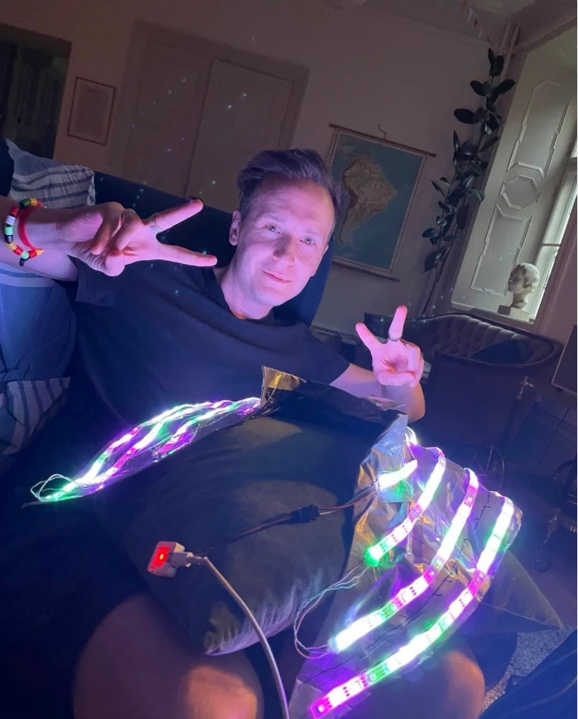

# ShinerCore Remote

The companion app to [ShinerCore](https://github.com/nevyn/shinercore), an open source
firmware for ESP32 controllers that animates addressable RGB LED strips (such as NeoPixel
strips). On the [App Store](https://apps.apple.com/app/id6451475618) for iPhone and iPad,
and the same code builds a Mac app.

Nearby cores appear in a list. Connect to one, and Play shows the whole show: power,
brightness, presets and every layer, with a live preview of the strip drawn by the
firmware's own animation code. Every control takes effect on the strip as you touch it.
The Wiring tab draws your board and gives each pin a job: a switch, a button, a knob, or
the LED strip itself.

    

What comes out the other end:

 

More light art at [@shiner.core](https://www.instagram.com/shiner.core/); the story behind
the project is [on nevyn.dev](https://nevyn.dev/wiki/portfolio/shinercore/).
