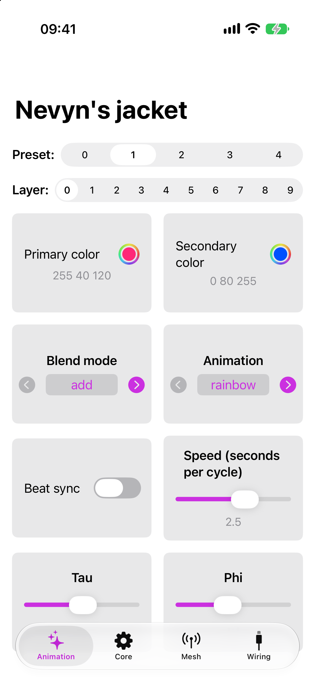
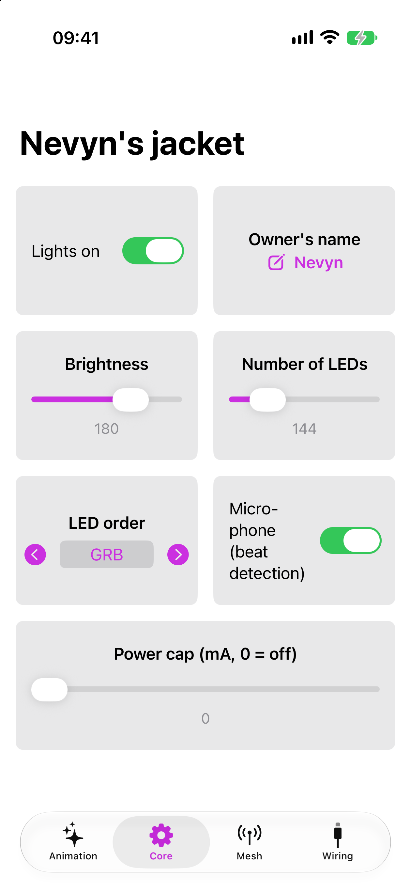
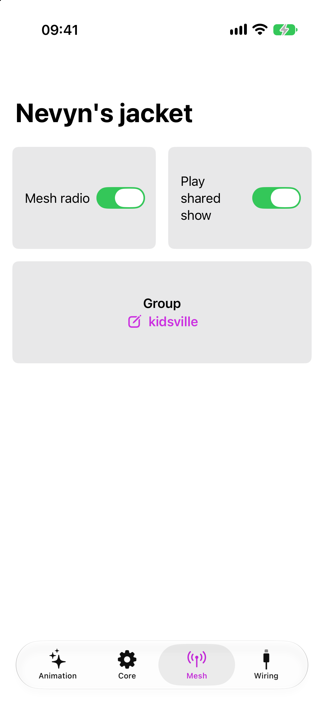

# ShinerCore Remote

The companion app to [ShinerCore](https://github.com/nevyn/shinercore), an open source
firmware for ESP32 controllers that animates addressable RGB LED strips (such as NeoPixel
strips). On the [App Store](https://apps.apple.com/app/id6451475618) for iPhone and iPad,
and the same code builds a Mac app.

Nearby cores appear in a list; connect to one and every control — animation, colors, speed,
brightness, layers and presets, beat sync, and the ESP-NOW mesh — takes effect on the strip
as you touch it.

   

What comes out the other end:

 

More light art at [@shiner.core](https://www.instagram.com/shiner.core/); the story behind
the project is [on nevyn.dev](https://nevyn.dev/wiki/portfolio/shinercore/).
